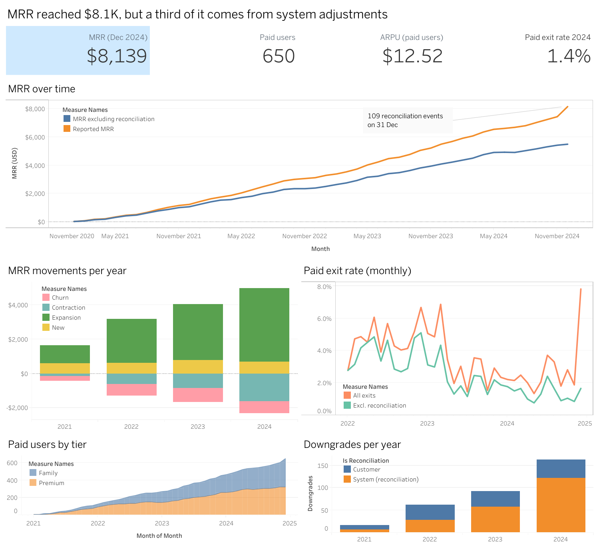
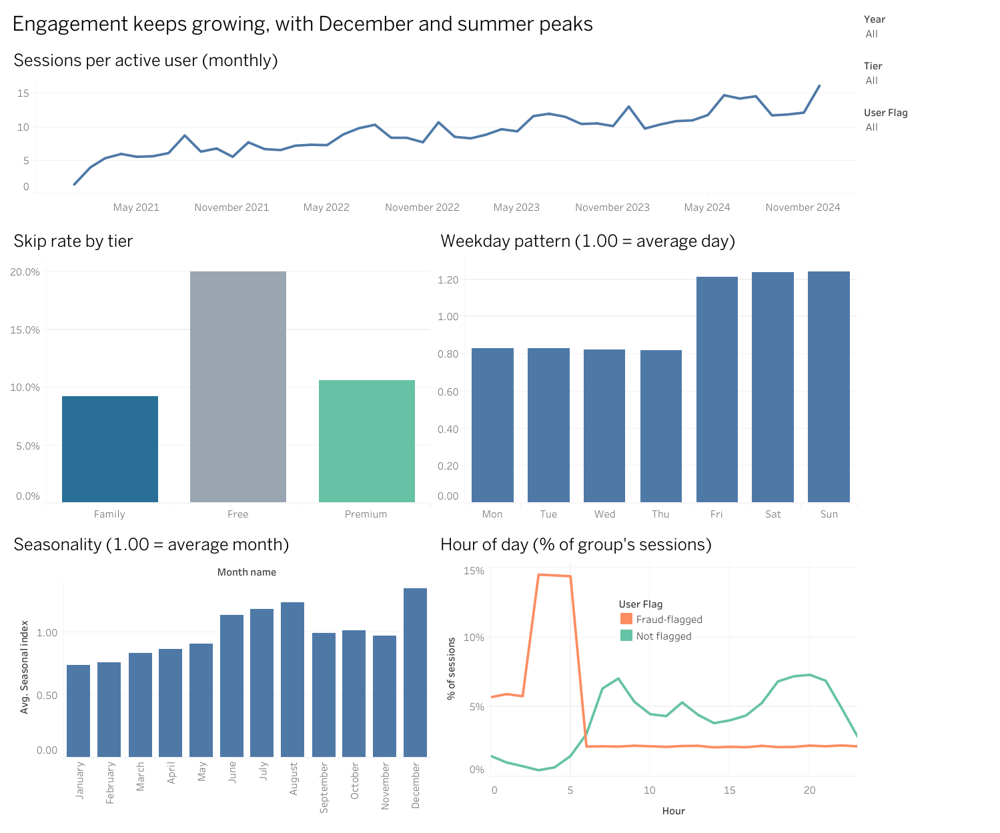
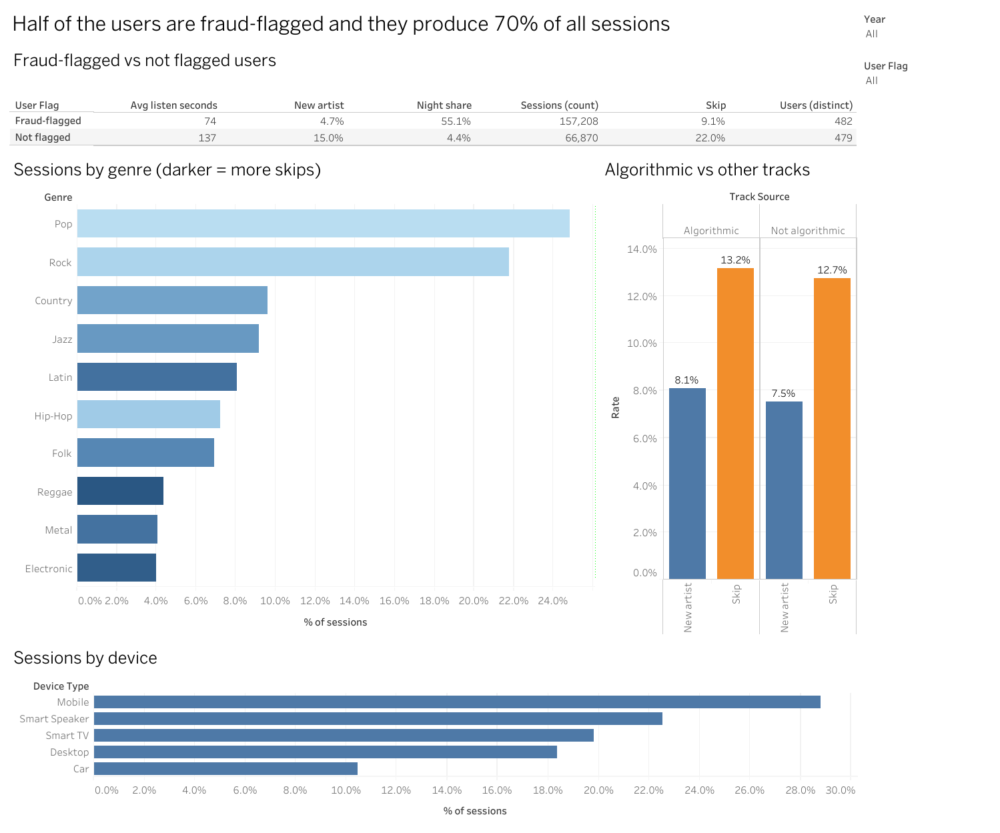

# Streaming Subscription and Engagement Dashboard (Tableau)

Tableau dashboard and data prep for a music streaming service: how recurring revenue (MRR) is growing, who is leaving, how people listen, and which parts of the data should not be trusted. The data covers 961 users, 224,078 listening sessions and 3,640 subscription events from 2021 to 2024.

**Live dashboard:** [Open on Tableau Public](https://public.tableau.com/shared/H8W5F2FSW?:display_count=n&:origin=viz_share_link)

## Dashboards

**1. Business health** (MRR, paid users, exits, downgrades)



**2. Engagement** (sessions, skips, weekdays, seasons, hours)



**3. Fraud flag and content** (flagged vs other users, genres, tracks, devices)



## Executive Summary

- **MRR grew from $1,249 (Dec 2021) to $8,139 (Dec 2024)**, and paid users from 108 to 650. Average revenue per paid user is $12.52.
- **Growth comes from upgrades, not new signups.** In 2024, upgrades added $4,277 of MRR and new signups only $689. Even counting only the upgrades customers chose themselves ($1,769), that is 2.6 times more than new signups.
- **Downgrades look bigger than cancellations, but only because of system changes.** In 2024 downgrades removed $1,594 of MRR and cancellations $724, but $1,259 of the downgrades are reconciliation events. Downgrades chosen by customers removed only $335.
- **Paid users leave less often.** The monthly paid exit rate (cancel or drop to Free), without system adjustments, fell from 3.8% in 2022 to 1.4% in 2024.
- **A third of today's MRR comes from system adjustments.** 655 plan changes (18% of all events) have the trigger "reconciliation" and add a net **$2,648 (32.5% of MRR)**. December 2024 looks like +9.6% MRR growth, but without these adjustments it is +0.9%.
- **Half of the users are flagged as fraud clusters** (482 of 961) and they produce **70.2% of all sessions**. They listen mostly at night, skip less and discover fewer new artists. They still pay like everyone else (49.5% of MRR).
- **Free users skip twice as often** as paid users (20.0% vs 10.6% Premium and 9.2% Family), and heavy free listeners upgrade more (62% in the heaviest quarter vs 45% in the lightest).

## Terms

- **MRR** (monthly recurring revenue): the monthly price of all paid subscriptions added together.
- **Paid users / ARPU:** users on Premium or Family, and the average MRR per paid user.
- **New, expansion, contraction, churn:** MRR added by new signups, added by upgrades, lost by downgrades, and lost by cancellations.
- **Paid exit:** a paid user who cancels or drops to Free.
- **Reconciliation:** a plan change made by the system (the event trigger is "reconciliation"), not by the customer.
- **Fraud cluster:** a flag in the data for users whose listening looks like streaming abuse.

## Business Questions

| Question | Short answer |
|---|---|
| How fast is MRR growing and where does it come from? | $1.2K to $8.1K in three years, mostly from upgrades |
| How many paid users leave? | 1.4% a month in 2024 (without adjustments), down from 3.8% |
| Is there a warning sign before a paid user cancels? | Listening drops 26% in the 30 days before a cancellation |
| Who listens, and when? | Fri to Sun are 1.5 times busier than Mon to Thu; December and summer peak |
| What do free users do before they upgrade? | The more they listen, the more they upgrade (62% vs 45%) |
| Does the algorithm help? | Not visibly: algorithmic tracks are 53.2% of the catalog and 52.5% of sessions |
| Is the data reliable? | Not fully: reconciliation events and the fraud flag change the picture |

## Dataset

- **Source:** DataDNA Dataset Challenge, Streaming Analytics (May 2026). The data dictionary says it was built with seeded patterns, so treat it as synthetic.
- **Original data:** 12 CSV tables (the `data` folder inside the challenge zip), copied unchanged into `data/raw/`. They are not pushed to GitHub (see `.gitignore`), so get them from the challenge zip.
- **How the data flows:**

```
12 original tables  ->  src/prepare_data.py  ->  4 files in data/  ->  Tableau
 (data/raw/)             (uses 8 of the 12)       (made by the script)
```

| Original table | Rows | Used |
|---|---|---|
| `fact_listening_session` | 224,078 | yes, one row per listening session |
| `fact_subscription_event` | 3,640 | yes, one row per subscription event |
| `dim_user` | 961 | yes, user country, tier, age and the fraud flag |
| `dim_country`, `dim_genre`, `dim_device`, `dim_track` | 10, 10, 366, 774 | yes, they give names to the ids in the sessions |
| `dim_subscription_plan` | 3 | yes, the monthly price of each plan |
| `dim_artist`, `dim_playlist`, `bridge_playlist_track`, `dim_date` | 448, 767, 21,192, 1,461 | no, this project is about subscriptions and listening, not artists or playlists, and Tableau builds dates by itself |

- **Why four new files:** Tableau would need the 8 tables joined together, and some numbers do not exist in the raw data at all (MRR at the end of each month, which events are paid exits or system changes). The script builds them once so Tableau only has to read the result.
- **Files used by Tableau** (made by `src/prepare_data.py`):

| File | Rows | One row is |
|---|---|---|
| `streaming_sessions.csv` | 224,078 | a listening session, with tier, country, device, genre and the user's fraud flag |
| `streaming_subscription_events.csv` | 3,640 | a subscription event (signup, upgrade, downgrade, churn, retention) |
| `streaming_monthly_mrr.csv` | 48 | a month: MRR at month end, paid users, MRR movements, paid exits, sessions, accounts |
| `streaming_users.csv` | 961 | a user with current tier, MRR, sessions and skip rate |

- **Definitions I added:**
  - `is_paid_exit`: a churn event from Premium or Family, or a downgrade to Free. In the source, 421 of the 635 churn events are from the Free tier and carry no revenue, so counting all churn events would overstate paid churn.
  - `is_reconciliation`: the event trigger is "reconciliation" (a plan change made by the system).
  - Month-end MRR is rebuilt from each user's last known MRR, and it matches the current plan prices of all users ($8,138.50).

## Tools

Python and Pandas for data prep, Tableau Public for the dashboard.

## Key Insights

### Revenue

- MRR at the end of each year: $1,249 (2021), $3,132 (2022), $5,495 (2023), $8,139 (2024).
- MRR movements in 2024: new +$689, expansion +$4,277, contraction -$1,594, churn -$724. Of the expansion, $2,508 are reconciliation events; of the contraction, $1,259. Without them: expansion +$1,769, contraction -$335.
- Paid exit rate per month (average): 4.7% in 2022, 3.4% in 2023, 2.8% in 2024. Without reconciliation events: 3.8%, 2.3% and 1.4%.

### Customer behaviour

- **Warning sign before cancelling:** in the 30 days before a paid user cancels, listening is 26% lower than in the 30 days before that (214 cancellations). Before a renewal it is 7% higher and before an upgrade 16% higher. This is a signal, not proof.
- **Free to paid:** 479 of 961 users (49.8%) upgraded from Free by their own choice, a median of 145 days after signup.
- **Engagement per account is growing:** 6.7 sessions per account per month in 2022, 9.3 in 2023, 11.5 in 2024.
- **Seasonality** (sessions per account, month divided by the year average, 2022 to 2024): December 1.35, August 1.24, January 0.74. Fri to Sun are 1.49 times busier than Mon to Thu.
- **Countries:** the share of paid users runs from 60% (United Kingdom) to 78% (France), but each country has only 70 to 126 users, so this is mostly noise.

### Content

- Pop and Rock are 46.6% of sessions.
- Algorithmic tracks are 52.5% of sessions and 53.2% of the catalog, with a skip rate of 13.2% vs 12.7% for the others: no clear advantage.

### Fraud flag

| | Fraud-flagged | Not flagged |
|---|---|---|
| Users | 482 | 479 |
| Sessions | 157,208 (70.2%) | 66,870 (29.8%) |
| Sessions per user | 326 | 140 |
| Sessions between 1 and 5 AM | 55.1% | 4.4% |
| Average listen (seconds) | 74 | 137 |
| Skip rate | 9.1% | 22.0% |
| New artist discovered | 4.7% | 15.0% |
| Current MRR | $4,032 | $4,107 |

Flagged users play many short sessions at night and almost never skip. That fits streaming abuse, but half of all users being flagged is also unusual, so the flag itself may be too broad. The dashboard has a filter so every chart can be viewed with and without them.

## Data Quality

| Check | Result |
|---|---|
| Duplicate keys; rows lost when joining the tables | None |
| Latest event tier equals the user's current tier | 961 of 961 |
| Sessions before the account was created | 0 |
| Event where `mrr_before` does not match the previous `mrr_after` | 1 (event 2601, $5 effect) |
| **Reconciliation events** | **655 of 3,640 (18.0%), net +$2,648 MRR** |
| **Reconciliation on 2024-12-31 alone** | **109 events** |
| **Users flagged as fraud cluster** | **482 of 961 (50.2%)** |
| Churn events from the Free tier (no revenue) | 421 of 635 |

- Because of the reconciliation events, the MRR chart has a second line without them, and the paid exit rate is shown both ways.
- `estimated_revenue_usd` in the sessions table adds up to only $852 for four years, against $8,139 of MRR in a single month. For paid tiers it is a per-stream royalty, which is a cost, not income. It is not used as revenue.

## Recommendations

1. **Check what "reconciliation" means** with the team that owns the data, and do not report MRR growth until it is clear. Reporting MRR with and without them is safer.
2. **Check the downgrades made by the system first.** In 2024, 122 of the 163 downgrades (75%) are reconciliation events, against 7 of 17 in 2021. Downgrades chosen by customers are 41 in 2024 and cost $335 of MRR, less than cancellations ($724).
3. **Build a cancellation alert** from a drop in listening, for paid users (a 26% drop in the month before cancelling), and test a retention offer on them.
4. **Nudge heavy free listeners to upgrade.** The heaviest quarter upgrades most (62%).
5. **Review the fraud flag.** If half the users are flagged, either the rule is too wide or the abuse problem is very large. Both need a decision before using engagement numbers for planning.

## Limitations

- The data is synthetic and built with seeded patterns, so results show the method, not a real business.
- Comparisons are descriptive, with no significance tests. Small groups (countries, age bands) are especially noisy.
- The pre-cancellation listening drop is based on 214 events.
- Month-end MRR depends on the event log. One event is inconsistent and a third of today's MRR comes from reconciliation events.

## Repository Structure

```
├── data/
│   ├── streaming_sessions.csv
│   ├── streaming_subscription_events.csv
│   ├── streaming_monthly_mrr.csv
│   ├── streaming_users.csv
│   └── raw/                  # challenge files, not committed
├── src/
│   └── prepare_data.py
├── images/                   # dashboard screenshots
├── requirements.txt
└── README.md
```

## How to Run

For the dashboard you only need the four files in `data/`. Open Tableau Public and connect to them, no Python needed.

To rebuild those four files from the raw data:

1. Install pandas: `pip install -r requirements.txt`
2. Unzip the challenge zip and copy the 8 raw CSV files listed in Dataset from its `data` folder into `data/raw/`.
3. Run `python src/prepare_data.py`. It works from any folder and saves the four files in `data/`.

If a raw file is missing, the script tells you which one.
